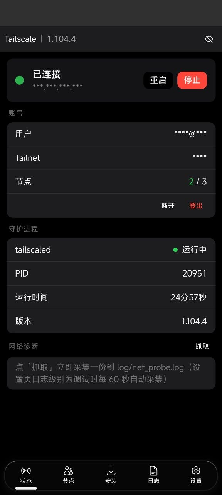
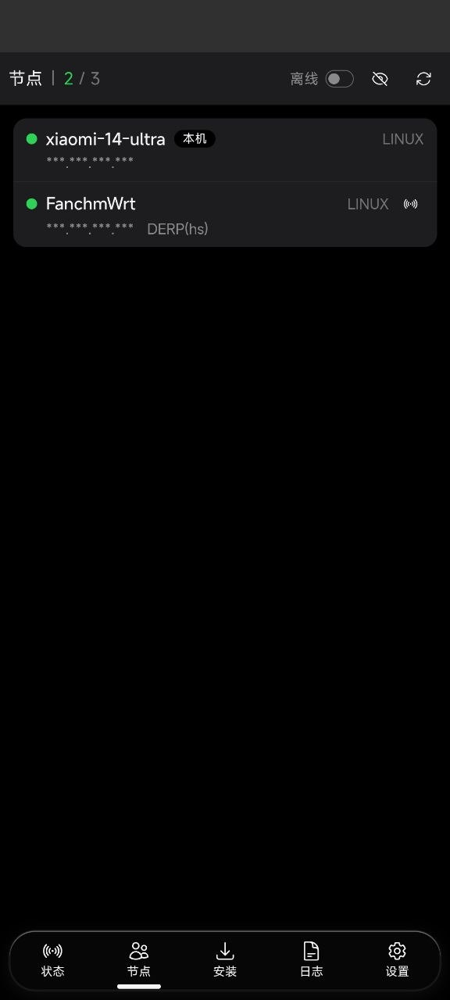
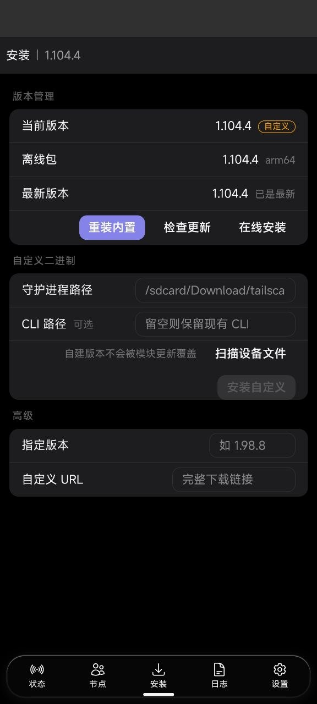
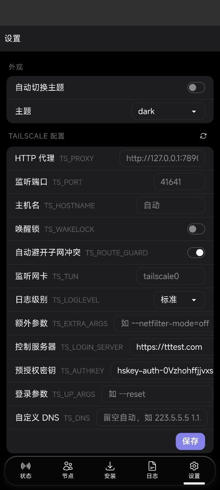

# Tailscale Root

一个 KernelSU / Magisk / APatch 模块：把 [Tailscale](https://tailscale.com) 以 root 守护进程的方式常驻运行在 Android 上，并附带内置 WebUI 进行管理。

## 特性

- **Root 守护进程**：`tailscaled` 直接以 root 运行，不占用系统 VPN 服务槽位
- **内置二进制**：官方 `tailscale` / `tailscaled`（arm64）随模块打包，开机自动部署，安装与升级全程离线
- **自建二进制**：可装入自己编译或第三方的 `tailscaled`，模块升级不会覆盖它
- **WebUI**：从 KernelSU 管理器直接打开
  - 状态总览（连接状态、账号、节点数、运行时长）
  - 节点列表与延迟测试（渐进式柱状图）
  - 版本管理：内置版本、在线版本、自定义二进制的安装与切换
  - 日志查看（按级别着色）
  - 设置：主题切换 + Tailscale 环境变量
  - 隐私开关（隐藏 IP、用户名）
  - KSU 模块描述随连接状态自动更新
- **Box for Root 集成**：自动探测 mihomo HTTP 代理用于控制面出网
- **src_valid_mark 守卫**：阻止 tailscaled 破坏 tproxy 类代理模块
- **唤醒锁**：可选的 CPU 唤醒锁，避免深度睡眠后数据面卡死
- **一键开关**：KSU 管理器的操作按钮可启动 / 停止

<p align="center">
  
  
  
  
</p>

## 安装

1. 下载最新 [release](https://github.com/RyanRaw/tailscale-root/releases) 的 zip
2. 通过 KernelSU / Magisk / APatch 管理器安装
3. 重启手机，内置二进制会自动部署到 `/data/adb/tailscale/bin/`
4. 从 KernelSU 管理器打开本模块的 WebUI，登录并连接

全部操作都可以在 WebUI 内完成，不需要命令行。

## WebUI 功能位置

| 页面 | 能做什么 |
| --- | --- |
| 状态 | 查看连接状态 / 账号 / 节点数；启动、停止、重启守护进程（含当前运行的二进制路径）；获取登录链接；断开、登出；网络诊断快照；Box Guard 状态 |
| 节点 | 查看所有节点、测延迟 |
| 安装 | 安装 / 切换 / 重装内置版本；在线安装（指定版本或自定义 URL）；在外置与内置之间手动切换，外置可一键删除并回滚（可扫描设备文件） |
| 日志 | 6 类来源（守护进程 / 网络诊断 / 登录 / 看门狗 / DNS / 二进制部署）；跟随刷新、清空当前日志 |
| 设置 | 主题；`TS_PROXY`、`TS_PORT`、`TS_HOSTNAME`、`TS_WAKELOCK`、`TS_ROUTE_GUARD`、`TS_TUN`、`TS_EXTRA_ARGS`、`TS_LOGIN_SERVER`、`TS_AUTHKEY`、`TS_UP_ARGS`、`TS_DNS`、`TS_LOGLEVEL` |

## 配置

一般直接在 WebUI 的设置页修改即可，写入 `/data/adb/tailscale/env`：

```sh
TS_PROXY="http://127.0.0.1:7890"  # 控制面 / DERP 使用的 HTTP 代理
TS_PORT="41641"                    # WireGuard 监听端口
TS_HOSTNAME="my-phone"             # 覆盖自动获取的主机名
TS_WAKELOCK="1"                    # 持有 CPU 唤醒锁（1 开，0 关）
TS_ROUTE_GUARD="1"                 # 子网重叠时自动关 accept-routes（1 开，0 关）
TS_TUN="tailscale0"                # TUN 网卡名
TS_EXTRA_ARGS=""                   # 追加给 tailscaled 的启动参数，如 --netfilter-mode=off
TS_DAEMON=""                       # 守护进程路径覆盖（留空即 /data/adb/tailscale/bin/tailscaled）
TS_LOGIN_SERVER=""                 # 自建控制服务器地址，留空即官方（如 https://headscale.example.com）
TS_AUTHKEY=""                      # 预授权密钥，可免去浏览器登录
TS_UP_ARGS=""                      # 追加给 tailscale up 的参数，如 --reset
TS_DNS=""                          # 自定义 DNS，留空自动（如 "223.5.5.5 1.1.1.1"）
TS_DNS_FALLBACK=0                  # 1 = 启用回环 DNS 兜底（仅在 androiddns 不可用时需要）
TS_DNS_UPSTREAM="223.5.5.5:53,119.29.29.29:53"  # 兜底转发器的上游 DNS
TS_LOGLEVEL="normal"               # 日志级别：quiet / normal / debug（debug 开启 tailscaled 详细日志）
```

### 局域网与对端子网重叠时自动切换

如果对端 advertise 的子网（例如 `192.168.4.0/24`）与本机当前所在局域网重叠，tailscaled 会把该网段
装进自己的路由表（`table 52`），而 `ip rule 5270: from all lookup 52` 优先级高于 netd 的打标表 ——
于是**所有 App** 访问本地路由器/NAS/打印机都会被塞进隧道绕一圈（实测 34ms + 33% 丢包，
直连 9ms + 0% 丢包）。

模块每 30 秒比对本机地址与对端 advertise 的子网（按 CIDR 位比较，不是按前三段猜）：

- **有重叠**（本机已在那个局域网）→ 自动 `tailscale set --accept-routes=false`，本地流量恢复直连
- **不再重叠**（切到 4G/别人家 Wi-Fi）→ 自动恢复 `--accept-routes=true`，仍能访问对端子网

只会撤销自己做的切换（标记文件 `/data/adb/tailscale/.accept_routes_auto`），不会覆盖手动设置。
过程记录在 `log/route_guard.log`，例如：

```
2026-10-30 21:33:01 local net overlaps advertised route -> accept-routes=false
```

### 日志级别与诊断

设置页的「日志级别」控制排障强度：

| 级别 | `log/tailscaled.log` | 网络快照 `log/net_probe.log` |
| --- | --- | --- |
| 静默 quiet | 不记录（输出丢弃到 `/dev/null`） | 不自动采集（只能手动抓取） |
| 标准 normal | 常规 | 每 5 分钟一条 |
| 调试 debug | 追加 `--verbose=2` 详细日志 | 每 60 秒一条 |

日志都有上限：`tailscaled.log` 超过 2 MB、`net_probe.log` 超过 512 KB 时会自动滚一代（`.old`），
运行时也会检查，不需要重启守护进程。

`log/net_probe.log` 每条记录包含：`route get`（v4/v6）、全部默认路由、main 表、网卡 IPv4、`/etc/resolv.conf`、
`net.dns1/2`、守护进程 pid 与 BackendState、`curl` 直连 GitHub 与登录服务器的返回码和时间、以及 tailscaled 最近的报错。

WebUI 日志页右上角可以切换日志源：守护进程 / 网络诊断 / 登录 / 看门狗 / DNS / 二进制部署。
状态页「网络诊断」的「抓取」按钮会立即写一条快照并展示出来。

## 自建控制服务器（Headscale）

支持任何兼容 Tailscale 控制协议的自建服务端（Headscale 等），全程在 WebUI 内配置：

1. 设置页 → **控制服务器** 填 `https://headscale.example.com`（留空即用官方服务器）
2. 可选：**预授权密钥** 填 Headscale 生成的 pre-auth key，登录时不再需要浏览器授权
3. 如果这个节点之前在官方服务器上注册过，把 **登录参数** 设为 `--reset`（会清空当前注册信息再重新注册）
4. 状态页点「获取链接」，在浏览器完成授权；成功后状态变为「已连接」

注意事项：

- 登录失败时状态页会直接显示 `tailscale up` 的原始错误，便于排查地址、证书或网络问题
- Headscale 使用自签证书时，需先把它的 CA 安装为系统信任的证书，或者换成 Let's Encrypt 签发的域名证书
- 切换控制服务器后建议在状态页用「重启」让守护进程重新连接；`--reset` 只需要在切换那一次使用
- DERP 中继默认走官方公共 DERP；如需只用自建 DERP，可在 `TS_EXTRA_ARGS` 中追加相应参数

## 自建 / 第三方 tailscaled

支持运行自己编译的守护进程（自行打补丁、`--netfilter-mode=off`、userspace networking 等），全程在 WebUI 内操作：

1. 把二进制或官方 tgz 包放到手机上，例如 `/sdcard/Download/`
2. 打开 WebUI → 安装页 → **外置二进制**
3. 点「扫描设备文件」自动列出常用目录（`/sdcard/Download`、`/sdcard`、`/data/local/tmp`）里的 tailscale 相关文件，点一下即可填入路径；也可以手动输入路径
4. 点「切换为外置」

支持的输入形式：

- 单个可执行文件 `tailscaled`（只替换守护进程，CLI 保持不变）
- 一个目录，内含 `tailscaled`，有 `tailscale` 时一并替换
- 官方 `.tgz` / `.tar.gz` 包（自动解包并取其中的 `tailscaled`、`tailscale`）
- 也可以单独填写「CLI 路径」来一并替换 `tailscale` 命令

安装过程会先复制到暂存文件并用 `--version` 试运行校验，架构不匹配或不是 tailscaled 的文件会被拒绝，不会破坏现有可用版本；校验通过后停止守护进程、原子替换并自动重启。

自定义版本会被标记为用户自管（`bin/.custom`），模块升级、开机自动部署都不会覆盖它；安装页顶部「当前来源」会显示现在跑的是内置还是外置，以及 `/proc/<pid>/exe` 里的真实路径。改回内置点「切换到内置」即可。

外置装完原始文件会留在原处（安装只复制副本）。点「删除外置」会：停守护进程 → 删掉 `bin` 下的外置副本与标记 → 一并删除外置存储（`/sdcard`、`/data/local/tmp` 等）上的来源文件 → 有内置包时自动回滚内置并重启守护进程。模块目录和系统路径下的文件一律不动。

自建版本如需额外参数，在设置页填 `TS_EXTRA_ARGS`；TUN 网卡名不同则改 `TS_TUN`。请保持进程名为 `tailscaled`（安装器已自动重命名），因为看门狗、KSU 操作按钮和状态检测都按该进程名匹配。

## 故障排查

### 报 `failed to resolve "<域名>"; no DNS fallback candidates remain`

```
Received error: fetch control key: Get "https://xxx:3443/key?v=148":
failed to resolve "xxx": no DNS fallback candidates remain for "xxx"
```

原因：Android 没有 `/etc/resolv.conf`，官方 APP 走系统 netd 解析，而本模块的 `tailscaled`
是**静态 Go 二进制**（无 cgo），默认只读 `/etc/resolv.conf`。

处理：1.104+ 的官方二进制自带 `androiddns` 特性 —— 启动时如果没有 `/etc/resolv.conf`，会检测
`/dev/__properties__` 与 `/dev/socket/dnsproxyd`，能连上就直接说 dnsproxyd 协议（和 bionic
`getaddrinfo` 同一条路，自带 per-network DNS 与 Private DNS）。**正常情况下不需要任何配置，
也不占用任何端口。**

出现这个报错时依次检查：

1. 二进制版本是否 < 1.104（WebUI 安装页可看），旧版没有该特性；
2. `su -c 'ls -l /dev/socket/dnsproxyd'` 是否存在、当前 SELinux 是否拦了连接；
3. 都不行时可开兜底：`env` 里 `TS_DNS_FALLBACK=1`，模块会在回环 `127.0.0.1:53` 起一个转发器，
   把查询转给 `TS_DNS_UPSTREAM`（默认 `223.5.5.5`、`119.29.29.29`）。该兜底只服务 tailscaled，
   不劫持系统 DNS、不写 `/system`；端口被别的程序占用时会让位，tailscaled 停止后随即释放。

改完 `env` 后重启一次 tailscaled，再回状态页点「获取链接」重新发起登录。

### 报 `connect: network is unreachable`

```
bootstrapDNS("derp9.tailscale.com", "207.148.3.137") ... dial tcp 207.148.3.137:443: connect: network is unreachable
```

原因：Android 的默认路由放在「按网络」的路由表里，靠 socket 的 fwmark 选中；App 由 netd 打标记，
而 **root（uid 0）的流量不带标记，只能查 main 表**，main 表通常是空的 → 所有外连都返回 ENETUNREACH，
DNS 兜底（bootstrap-dns）随之全灭。

处理：模块会把当前默认网络的默认路由镜像到 main 表（只影响 root，不影响 App），启动时执行一次，
之后由看门狗每 30 秒自检并自动补回，不需要手动干预。

状态页「网络诊断」可以一键查看：`ip route get 1.1.1.1`、现有默认路由、main 表、`/etc/resolv.conf`、
DNS 系统属性、以及 ping 测试结果，排查时把这段输出发出来即可。

### 其它常见问题

- **切换控制服务器后登录报错**：设置页把 `TS_UP_ARGS` 设为 `--reset` 再登录一次（只需一次）
- **自签证书报 TLS 错误**：把服务端 CA 装进系统证书，或改用受信任的域名证书
- **登录链接拿不到**：状态页会显示 `tailscale up` 的原始错误，按提示排查地址/证书/网络
- **自建二进制跑不起来**：安装页会显示 `--version` 的实际输出，多为架构不匹配（如 32 位设备装了 arm64 包）

## 项目结构

```
module/                 # KSU 模块文件（打包发布的内容）
├── module.prop
├── bins/               # 内置二进制：bins/<arch>/{tailscale,tailscaled,VERSION}
├── install_bins.sh     # 部署 / 更新内置二进制
├── install_custom.sh   # 安装自建二进制（标记为用户自管）
├── update_resolv.sh    # 生成 /etc/resolv.conf（静态 Go 二进制不认 netd）
├── ts_up.sh            # 按 env 配置登录（支持自建控制服务器 / 预授权密钥）
├── system/etc/resolv.conf  # 叠加到 /system 的 DNS 配置占位文件
├── service.sh          # 守护进程启动 + 模块描述更新
├── action.sh           # KSU 操作按钮：一键启停
├── svm_guard.sh        # src_valid_mark 看门狗 + 健康检查
├── update_desc.sh      # 模块描述状态刷新
├── post-fs-data.sh     # 目录初始化 + 内置二进制部署
└── webroot/index.html  # 构建后的 WebUI（单文件）

webui/                  # WebUI 源码（Vue 3 + Tailwind CSS + DaisyUI）
├── src/
│   ├── composables/useKsu.ts   # KSU exec 桥接与状态管理
│   ├── views/                  # 页面组件
│   └── ...
├── package.json
└── vite.config.ts
```

## 构建 WebUI

```sh
cd webui
npm install
npm run build
cp dist/index.html ../module/webroot/index.html
```

## 模块描述

模块会每 30 秒刷新一次 KernelSU 管理器中的描述：

- `✅ 已连接 | hostname | 100.x.x.x | N 个在线 | vX.Y.Z`
- `⚠️ 需要登录 | vX.Y.Z`
- `❌ 未运行`

## 许可

MIT
